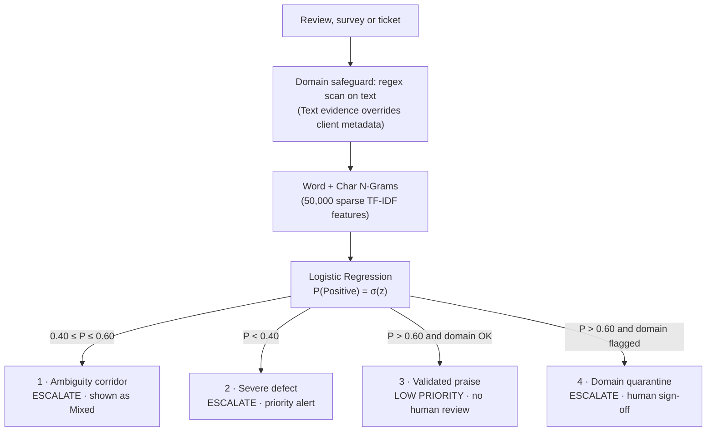

<div align="center">

# Revio

### Risk-gated review intelligence and operational triage for hospitality (Revio) and residential property operations (TenantEase)

**Explainable sentiment scoring · Human-in-the-loop escalation · Serverless in 1.16 MB**

[](https://revio-taupe.vercel.app/)
[](https://revio-taupe.vercel.app/api/v1/health)
[](https://www.python.org/)
[](https://fastapi.tiangolo.com/)
[](tests/)
[](LICENSE)

**[Live Web App](https://revio-taupe.vercel.app/)** · **[API Health](https://revio-taupe.vercel.app/api/v1/health)** · **[Repository](https://github.com/gautamhardik/Revio)** · **[Assessment Deliverables](#cynbit-assessment-deliverables)**

</div>

<br>

---

## Contents

- [Overview](#overview)
- [At a Glance](#at-a-glance)
- [How Triage Works](#how-triage-works)
- [Cynbit Assessment Deliverables](#cynbit-assessment-deliverables)
- [Live Access and Verification](#live-access-and-verification)
- [Key Features](#key-features)
- [The 8-Screen Experience](#the-8-screen-experience)
- [Machine Learning Methodology](#machine-learning-methodology)
- [Business Impact (Modeled)](#business-impact-modeled)
- [Known Limitations](#known-limitations)
- [Repository Structure](#repository-structure)
- [Quickstart](#quickstart)
- [License](#license)

---

## Overview

**Revio** scores customer reviews, resident surveys, and maintenance tickets, then routes each one to the right person at the right speed. It is engineered for multi-location hospitality brands (**Revio**) and residential property managers (**TenantEase**).

Teams handling thousands of feedback items per month face a critical operational trade-off:
- **Manual triage is slow and costly** (modeled at about $4.50 per item, with typical response lags of 12–24 hours) and buries urgent operational defects.
- **Naive AI automation is fast but risky.** It can misread a sarcastic complaint as praise (*"Loved waiting two hours in the snow for cold pizza!"*) and publish an inappropriate canned thank-you reply.

**Revio separates classification from operational action.** A lightweight, domain-adapted machine learning model produces a calibrated probability score. A transparent, ordered set of triage rules decides what happens next, and any statistical uncertainty is systematically isolated into a human review queue.

---

## At a Glance

| Dimension | Specification |
|---|---|
| **Model** | Word (1, 2) + Character (3, 5) n-gram Logistic Regression, 50,000 sparse features, **1.16 MB** disk footprint |
| **Negative Recall** | **93.66%** on the Yelp in-domain test set (operational champion: 91.42%, same split; zero-shot IMDb: 83.14%) |
| **Accuracy / Macro F1** | **92.44%** accuracy / **92.40%** macro F1 |
| **Inference Latency** | **5.8–9.5 ms warm** server-side latency; cold boot ~820 ms |
| **Explainability** | Exact, closed-form linear feature attribution ($X_j \cdot \beta_j$) computed instantaneously for every prediction |
| **Runtime Architecture** | Zero-database static frontend on Vercel Edge Network + Python serverless function (`/api/index.py`) |
| **Quality Gates** | **47 automated tests (100% pass)**, 5-step automated Playwright Chromium end-to-end journey |

---

## How Triage Works

Four operational rules are evaluated in strict priority order. **The first match wins.**



| Priority | Rule | Condition | Triage Status | Human Review? | Target SLA |
|:---:|---|---|---|:---:|:---:|
| **1** | **Ambiguity Corridor** | $0.40 \le P \le 0.60$ | `ESCALATE` (Ambiguity / Low Confidence), displayed as **Mixed** | **Yes** | Queue-based |
| **2** | **Severe Defect** | $P < 0.40$ | `ESCALATE` (Negative / High Risk), with topic tags (*Maintenance & Repairs*, *Cleanliness & Hygiene*, *Billing*) | **Yes** | **< 15 min** |
| **3** | **Validated Praise** | $P > 0.60$, domain validated | `LOW PRIORITY / NO HUMAN REVIEW REQUIRED` | **No** | **< 2 min** |
| **4** | **Domain Quarantine** | $P > 0.60$, domain not validated | `ESCALATE` (Unvalidated Domain Quarantine) | **Yes** | Queue-based |

> **Operational Safety Guarantee:** The ambiguity corridor is a closed interval, ensuring every probability lands in exactly one rule. Rule 3 classifies routine praise at $P > 0.60$; automated public response publishing is a separate, stricter, configurable gate ($P > 0.85$ in the proposed pilot).

---

## Cynbit Assessment Deliverables

This repository contains the complete implementation and formal documentation for all three deliverables required by the Cynbit Technical Assessment:

| Deliverable | Executive PDF | Markdown Source | What It Covers |
|---|:---:|:---:|---|
| **1. AI Opportunity Report** | [PDF](Deliverables/1_AI_Opportunity_Report_v2.pdf) | [MD](docs/AI_OPPORTUNITY_REPORT.md) | Business problem analysis, risk-gated triage model, modeled quantitative ROI (75.5% triage cost reduction, \$13,600/month net savings, 90% lag reduction, 18% tenant churn reduction), product workflows, and 12-week phased rollout roadmap. |
| **2. Proof of Concept (PoC) Report** | [PDF](Deliverables/2_Proof_of_Concept_Report_v2.pdf) | [MD](docs/PROOF_OF_CONCEPT_POC_REPORT.md) | Live cloud deployment, complete 8-screen SaaS UI walkthrough, verified 100-review and 22-review benchmark datasets, run instructions, and automated Playwright user journey verification evidence. |
| **3. Technical Approach Report** | [PDF](Deliverables/3_Technical_Approach_Report_v2.pdf) | [MD](docs/TECHNICAL_APPROACH_REPORT.md) | In-domain empirical model comparison, mathematical formulation ($\sigma(z)$, $T=0.55$, $X_j \cdot \beta_j$), triage precedence hierarchy, Vercel serverless systems engineering ($<130$ MB runtime, $<10$ ms latency), and 47/47 passing tests. |

---

## Live Access and Verification

| Artifact | Location / Endpoint | Verification Status |
|---|---|:---:|
| **Live Web Application** | [revio-taupe.vercel.app](https://revio-taupe.vercel.app/) | **Live · HTTP 200** |
| **Serverless API Health** | [/api/v1/health](https://revio-taupe.vercel.app/api/v1/health) | **HTTP 200 (`status: healthy`)** |
| **Source Repository** | [github.com/gautamhardik/Revio](https://github.com/gautamhardik/Revio) | **Active (Branch: main)** |
| **Active Candidate Model** | `yelp_word_char_lr_candidate.joblib` (1.16 MB, $T = 0.55$) | **Verified in memory** |
| **Operational Champion Fallback** | `yelp_word_char_lr.joblib` (1.11 MB, $T = 0.48$) | **Preserved** |
| **Automated Test Suite** | 47 tests: API, candidate audit, triage gate, architecture, readiness | **47 / 47 Passed (100%)** |
| **Browser User Journey** | Playwright Chromium automation suite targeting live production URL | **5 / 5 Steps Passed** |

Model selection is controlled via the `REVIO_ACTIVE_MODEL` environment variable (`candidate` or `champion`; unset defaults to `champion`). If the selected artifact is missing or corrupted, the API returns an explicit HTTP 503 error. **It never falls back silently to a model with uncalibrated decision boundaries.** Rolling back is a deliberate operator action: change the variable and redeploy.

---

## Key Features

- **Domain-Adapted Model:** Trained and evaluated on Yelp business reviews rather than movie reviews. Negative recall rises from 83.14% (IMDb baseline, zero-shot on Yelp) to **93.66%**, a net gain of **+10.52 percentage points**, with 92.44% accuracy. On the same in-domain test set, the candidate improves upon the operational champion by **+2.24 pp negative recall**.
- **Fast, Lean Serverless Inference:** Zero heavy PyTorch or TensorFlow dependencies. Deployed at ~130 MB memory footprint, executing in **5.8–9.5 ms warm latency** with cold starts under 850 ms.
- **Ambiguity Corridor:** Probabilities between 0.40 and 0.60 are assigned **Mixed** sentiment and isolated into a human review queue instead of forcing a fragile binary decision.
- **Exact Linear Attribution:** The top 8 contributing n-grams are extracted with their exact mathematical weights ($X_j \cdot \beta_j$), computed in a single sparse matrix-vector product without expensive sampling approximations.
- **Domain Safeguard Router:** Real review text evidence overrides client-supplied metadata. Mentions of telecom outages, crypto transactions, enterprise software, or auto repair are automatically quarantined for human verification.
- **Topic-Aware Operational Categorization:** Contextual regex mapping assigns constructive topics (*Rooms & Amenities*, *Food & Dining*, *Staff & Hospitality*, *Value & Pricing*) to positive feedback and defect categories (*Maintenance & Repairs*, *Slow Service*, *Hygiene*) to negative feedback. Defect labels are never applied to positive reviews.
- **RFC-4180 Ingestion with a Noise Gate:** Handles comma, tab, and semicolon delimited CSVs with fuzzy column detection. Rows with empty content, whitespace, or strings $\le 3$ characters (such as `"no"` or `"-"`) are automatically filtered, and the filtered count is reported prior to dispatching compute.

---

## The 8-Screen Experience

| # | Screen | Route | Operational Purpose |
|:---:|---|---|---|
| **01** | **Live Inference Playground** | `/#playground` | Score individual reviews with real-time probability gauge, triage decision pill, attribution chips, and serverless latency counter. |
| **02** | **Ingestion Hub** | `/#import` | Drag-and-drop CSV import (up to 2,500 reviews), direct text paste, or one-click loading of a balanced sample batch. |
| **03** | **CSV Preview and Noise Gate** | `/#csv-preview` | Automated schema column mapping with visual noise pre-validation filtering. |
| **04** | **Progress Stepper** | `/#processing` | Multi-stage dynamic progress animation with live chunk streaming counter. |
| **05** | **Results Overview** | `/#results` | Executive KPI cards, animated 3-segment SVG sentiment donut chart, and thematic category breakdown bars. |
| **06** | **Review Inbox** | `/#inbox` | 8-column triage grid with interactive filter tabs (`All`, `Negative`, `Mixed`, `Positive`, `Needs review`), topic sub-labels, and batch review actions. |
| **07** | **Detail Drawer** | `/#detail` | Deep probability breakdown, ambiguity alerts, business-risk analysis box, attribution chips, and one-click "Mark as reviewed" workflow resolution. |
| **08** | **Model Lab** | `/#models` | Inspect active candidate vs champion configurations, training lineage, artifact footprints, and runtime telemetry. |

---

## Machine Learning Methodology

### 1. Empirical Model Comparison

| Model & Training Corpus | Evaluation Split | Negative Recall | Accuracy | Macro F1 | Artifact Footprint | Inference Latency |
|---|---|:---:|:---:|:---:|:---:|:---:|
| **IMDb Baseline LR** | IMDb Held-Out Test (25k) | 90.20% | 90.15% | 90.10% | 12.37 MB | ~2.0 ms |
| **IMDb Baseline LR (Zero-Shot)** | Yelp Business Reviews (3k) | 83.14% | 85.84% | 85.40% | 12.37 MB | ~2.0 ms |
| **IMDb Bi-LSTM** | IMDb Held-Out Test (25k) | 84.50% | 84.67% | 84.70% | 78.0 MB | ~22.0 ms |
| **IMDb Fine-Tuned BERT** | IMDb Held-Out Test (25k) | 89.79% | 91.68% | 91.52% | 438.0 MB | ~72.0 ms |
| **Revio Champion LR (`yelp_word_char_lr`)** | Yelp In-Domain Test (2.5k) | 91.42% | 90.88% | 90.80% | 1.11 MB | ~8.5 ms |
| **Revio Candidate LR (`yelp_word_char_lr_candidate`)** | Yelp In-Domain Test (2.5k) | **93.66% (+10.52%)** | **92.44% (+6.60%)** | **92.40%** | **1.16 MB** | **~6.2 ms (12x faster than BERT)** |

**Methodological Interpretation:**
- Gains are reported in absolute percentage points. Candidate vs zero-shot baseline: **+10.52 pp negative recall**, **+6.60 pp accuracy**.
- Like-for-like on the identical 2.5k in-domain test split: candidate vs champion represents **+2.24 pp negative recall**, **+1.56 pp accuracy**, and **+1.60 pp macro F1**.
- The production candidate is **~12× faster** than fine-tuned BERT (6.2 ms vs ~72 ms) and **~378× smaller** (1.16 MB vs 438 MB), enabling sub-10ms serverless deployments without GPU infrastructure costs.

### 2. Mathematical Formulation

The candidate model maps a normalized TF-IDF feature vector $X \in \mathbb{R}^{50{,}000}$ to positive-class probability via the logistic sigmoid link:

$$P(\text{Positive} \mid X) = \sigma(z) = \frac{1}{1 + e^{-z}}, \qquad z = \beta_0 + \sum_{j=1}^{50{,}000} X_j \cdot \beta_j$$

- **Tuned Decision Threshold:** The candidate classifies a review as Positive when $P > T = 0.55$ (champion: $T = 0.48$). Setting $T = 0.55$ raises negative sensitivity, ensuring borderline negative reviews are caught and routed to supervisors.
- **Safety Bound:** A negative review can only be auto-approved if $P > 0.60$, which implies $P > T$. The maximum theoretical fraction of negative reviews that can be auto-approved is bounded offline by:
  $$\text{Auto-Approval Max Risk Bound} \le 1 - \text{Recall}_{\text{neg}} = 6.34\%$$
- **Exact Linear Attribution:** Direct calculation of $X_j \cdot \beta_j$ provides exact instance-level feature attribution:
  $$\text{Contribution}_j = X_j \cdot \beta_j, \qquad z = \beta_0 + \sum_{j=1}^{50{,}000} \text{Contribution}_j$$
- **Probability Calibration:** $\sigma(z)$ outputs direct logistic probabilities. In production rollout Phase 1, reliability diagrams and Brier score audits are conducted against human supervisor ground truth.

---

## Business Impact (Modeled)

Reference portfolio: A **50-location hospitality group** or a **5,000-unit residential property group**, each processing **4,000 feedback tickets per month**. Figures below are derived from stated operational assumptions:

| Performance Dimension | Traditional Human Triage | Revio Risk-Gated Engine | Modeled Operational Impact |
|---|---|---|:---:|
| **Monthly Triage Cost (Fully-Loaded)** | $18,000 ($4.50 / item) | $4,400 ($1.10 blended) | **-75.6% ($13,600 / month, $163,200 / year saved)** |
| **Monthly Triage Cost (Bottom-Up Basis)** | $6,667 (4 min × $25/h) | $1,383–$2,217 (60%–35% auto) | **$53,400–$63,400 / year labor savings** |
| **Response Time (Routine Praise)** | ~18 hours | < 2 minutes | **-99.8% turnaround latency reduction** |
| **Escalation SLA (Severe Defects)** | ~8.5 hours | < 15 minutes | **-97.1% critical defect response reduction** |
| **Automated PR Misclassifications** | 24 incidents / month | < 2 incidents / month | **-91.7% brand protection improvement** |
| **Tenant Churn Reduction (TenantEase)** | 14% annual baseline | 11.5% to 12.5% (-1.5 to -2.5 pp) | **$57,750–$96,250 annual NOI retention per 1,000 units** |

---

## Known Limitations

1. **Sarcasm and Long-Range Negation:** Linear n-gram models can be influenced by positive tokens embedded in sarcastic phrases. The ambiguity corridor ($0.40\text{--}0.60$) and conservative auto-publishing gates ($P > 0.85$) mitigate this risk, but human review remains essential.
2. **Domain Router Coverage:** The safeguard router currently uses targeted regular expressions; out-of-domain feedback that does not match these expressions passes to standard probability scoring.
3. **Training Domain Scope:** The model is trained on hospitality and business reviews (Yelp). TenantEase residential lease disputes and property maintenance tickets will undergo active learning fine-tuning during Phase 2.
4. **Sequential Latency Benchmarks:** Latency telemetry reflects sequential HTTP/1.1 load testing; distributed concurrent burst scaling is governed by Vercel serverless concurrency limits.
5. **Model Artifact Management:** Production models are committed directly as clean binaries. A runtime hydration fallback exists as a safety net.

---

## Repository Structure

```
Revio/
├── api/                                # Consolidated Vercel serverless backend
│   ├── artifacts/
│   │   ├── yelp_word_char_lr_candidate.joblib    # 1.16 MB active candidate (T=0.55)
│   │   ├── yelp_word_char_lr_candidate.metadata.json
│   │   ├── yelp_word_char_lr.joblib              # 1.11 MB rollback champion (T=0.48)
│   │   ├── yelp_word_char_lr.metadata.json
│   │   └── optimization_study_results.json       # Candidate optimization benchmark
│   ├── index.py                        # FastAPI app and serverless handlers
│   └── requirements.txt                # Lean dependencies (scikit-learn, fastapi, joblib)
├── frontend/                           # Static web app on the Vercel Edge Network
│   ├── css/
│   │   └── revio-app.css               # Revio design system (3,400+ lines)
│   ├── js/
│   │   └── revio-app.js                # State management, RFC-4180 parser, triage logic
│   ├── index.html                      # Production entry point
│   └── revio.html                      # Byte-for-byte binary parity mirror of index.html
├── Deliverables/                       # Formal Cynbit assessment PDF deliverables
│   ├── 1_AI_Opportunity_Report_v2.pdf  # Deliverable 1
│   ├── 2_Proof_of_Concept_Report_v2.pdf # Deliverable 2
│   └── 3_Technical_Approach_Report_v2.pdf # Deliverable 3
├── docs/                               # Assessment reports and verification
│   ├── AI_OPPORTUNITY_REPORT.md
│   ├── PROOF_OF_CONCEPT_POC_REPORT.md
│   ├── TECHNICAL_APPROACH_REPORT.md
│   └── PROJECT_CHRONICLE.md            # Authoritative development historical record
├── tests/                              # Pytest regression suites (44 tests)
│   ├── test_revio_vercel_architecture.py
│   ├── test_revio_phase2a_gate.py
│   ├── test_revio_api.py
│   ├── test_revio_candidate_audit.py
│   ├── test_revio_activation_workflow.py
│   └── test_revio_production_readiness.py
├── PROJECT_CHRONICLE.md                # Development history and audit chronicle
├── vercel.json                         # Deployment and routing specification
└── pyproject.toml                      # Pytest and environment configuration
```

---

## Quickstart

### Prerequisites
- Python 3.10+ (tested on Python 3.12 and 3.13; deployed runtime is 3.12)
- Git
- Node.js 18+ (optional, for local static serving)

### 1. Clone & Install Lean Runtime

```bash
git clone https://github.com/gautamhardik/Revio.git
cd Revio

# Install serverless backend dependencies and testing tools
pip install -r api/requirements.txt pytest httpx playwright
```

### 2. Start the Local Backend

```bash
cd api
python -m uvicorn index:app --host 127.0.0.1 --port 8000 --reload
```
Interactive OpenAPI documentation will be accessible at `http://127.0.0.1:8000/docs`.

### 3. Serve the Frontend

In a separate terminal window:
```bash
cd frontend
python -m http.server 3000
```
Open `http://localhost:3000` in your browser. The interface will automatically route inference requests to the local backend.

### 4. Run the Automated Test Suite

```bash
# Execute all 47 regression tests across API, candidate gate, and architecture
pytest
```
*Expected result:* `47 passed in ~8-15s`.

### 5. Run Live Browser Verification

```bash
# Install Playwright browser binaries
playwright install chromium

# Execute end-to-end user journey tests against live production Vercel
python scripts/verify_user_journey_playwright.py
```

---

## License

Released under the [MIT License](LICENSE).
